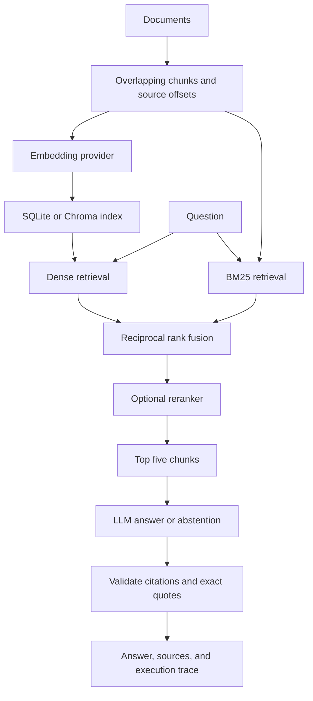

# Project Brief · Evidence Desk

An AI workflow portfolio project for document question answering with inspectable retrieval, cited claims, and explicit abstention. The original CSV reporting workflow remains available in `app.py`; see [reporting documentation](docs/REPORTING.md).

**Status:** all 30 tests, including API integration, and the offline evaluation gate passed in [GitHub Actions on Python 3.11 and 3.13](https://github.com/Adam-Skarre/project-brief/actions/runs/39173329529). The core and offline retrieval evaluation also run locally. Live model, Chroma, Langfuse, Docker, and browser integration require verification in an environment with their dependencies/services. Offline mode is a lexical retrieval demonstration and never pretends to generate an LLM answer. This is an independent portfolio project, not an MTA deployment or evidence of enterprise AI experience.

## Run the document app

Python 3.11+:

```bash
python -m venv .venv
source .venv/bin/activate
pip install -r requirements.txt
uvicorn rag_api:app --host 127.0.0.1 --port 8766
```

Open http://127.0.0.1:8766. Load project documentation, index it, and ask “What evidence must a generated claim include?” With default settings, inspect retrieved excerpts; a live generator must be enabled to receive answers. Upload `.md` or `.txt` files to use your own authorized documents. PDF parsing is not implemented.

## Architecture



Three selectable experiments: dense baseline; dense + BM25 fused with RRF; hybrid retrieval + reranking. Offline vectors use signed lexical hashing. Offline reranking uses query coverage. OpenAI/Ollama adapters provide learned embeddings and generation; Cohere provides semantic reranking. The SQLite backend performs exact cosine search; optional Chroma provides a persistent vector database.

Answers use a strict JSON schema. Each claim needs a known source ID and an exact supporting quotation. Validation rejects invented citations and quotations; it **cannot prove that the quote entails the claim**. Prompt injection instructions are treated as document data, and the generator has no execution tools. These controls reduce risk without guaranteeing factuality or injection resistance.

## Enable a real model

Set server environment variables (the app does not automatically load `.env` outside Docker):

```bash
export OPENAI_API_KEY='your-key'
export OPENAI_MODEL='your-supported-structured-output-model'
export RAG_DAILY_CAP_USD='your-positive-budget'
export RAG_EMBEDDING_MAX_USD='your-conservative-per-call-bound'
export RAG_GENERATION_MAX_USD='your-conservative-per-call-bound'
```

Use actual positive numbers for budget values. Choose OpenAI embeddings in the UI and enter a model ID available to your account, then index documents and choose the OpenAI generator. For Cohere, configure `COHERE_API_KEY`, `COHERE_RERANK_MODEL`, and `RAG_RERANK_MAX_USD` and select the reranking experiment.

Alternatively run Ollama locally, pull an embedding model and a generation model, set `OLLAMA_MODEL` for generation, and enter the embedding model ID in the UI. Requests target `127.0.0.1:11434`. A container's loopback is not the host: the supplied Docker configuration does not connect to host Ollama automatically.

Install `requirements-optional.txt` for Chroma or Langfuse. Langfuse requires explicit `LANGFUSE_ENABLED=true` plus its server/key settings. Enabling tracing can transmit raw prompts and source contents. Local traces are stored even without Langfuse.

## Reproduce evaluation

```bash
python -m unittest discover -s tests -v
python eval_rag.py
```

The development corpus contains eight project-documentation files, 24 answerable questions, and four unanswerable questions. Questions and exact evidence spans are in `evaluation/questions.jsonl`. They are author-created and **not independently human-verified**. The evaluator maps relevant chunks from those spans; an unmapped span fails the run instead of silently dropping a question. Overlapping chunks containing a gold span each count as relevant.

[Recorded offline results](evaluation/retrieval_results.json) compare three chunk sizes and three retrieval configurations. Recall@20 is trivially 1.0 because this corpus has fewer than 20 chunks; do not present it as retrieval quality evidence. At 60 words, MRR was 0.7410 for the dense lexical baseline, 0.8339 for hybrid, and 0.9375 with lexical reranking. These are development observations, not learned-embedding results or proof of generalization. Precision@5 uses five slots; most questions have one relevant chunk, so its maximum is often 0.2. Latency measures retrieval only on this machine.

Compare two available learned embedding models with the same questions:

```bash
python eval_rag.py --embedding openai --models text-embedding-3-small text-embedding-3-large --sizes 60 120 180 --reranker cohere --generator openai --output evaluation/live_results.json
python review_rag.py export evaluation/live_results.json.answers.json
python judge_rag.py evaluation/generation_review.csv
python review_rag.py score evaluation/judged_review.csv
```

Live evaluation makes paid calls across every combination. Review corpus labels first, reserve an appropriate budget, and start with one model/size. Model IDs above are examples; confirm account availability. The judge additionally requires `OPENAI_JUDGE_MODEL`. Have a human independently label at least 20% of outputs (include failures and abstentions); fill the human columns with `0` or `1`. Do not look at judge labels while annotating. Scoring reports coverage and Cohen's kappa separately for groundedness, relevance, and hallucination. Undefined kappa is `null`. No quality score is reported without labels. Improve the judge rubric and repeat calibration before using judge scores as a release gate. Retrieval labels, test questions, and human review need a larger held-out dataset before serious comparisons.

## Operations and deployment

- Cache keys include corpus identity, retrieval/generation choices, models, and prompt/pipeline version. Answers expire after one hour.
- Paid requests reserve configured per-call amounts in a transactional rolling 24-hour ledger. Reservations are **not actual charges**. Failed calls keep reservations. Bounds must account for model prices and maximum input/output sizes; use provider billing controls too. Budgets are per database; app and evaluation use separate ledgers by default.
- The UI exposes source excerpts, line numbers, timing, provider usage, cache status, and exportable JSON. SQLite retains traces; there is no automatic trace/index retention purge.
- The API requires bearer authentication, limits request size, and defaults to 12 authenticated requests/minute globally. It is a single-operator app. Run one worker; rate counters are process-local. A shared token is not a replacement for multi-user authorization.

```bash
cp .env.example .env
# Edit .env: set a long random access token and any provider settings.
docker compose up --build
```

Docker binds host port 8766 to loopback and persists the database in a named volume. Public mode refuses startup without a token of at least 24 characters. Enter that token in the UI. For remote deployment, use a TLS reverse proxy, a persistent writable volume, one worker, server-side secrets, and resource limits. Do not expose the legacy CSV server as the public service. Optional Chroma/Langfuse packages are excluded from the default Docker image; change its requirements input if needed.

For a container host, deploy this Dockerfile with port 8766, health path `/health`, and a writable volume at `/app/local_data`. No public hosting deployment has been performed. Model keys never belong in GitHub or browser code. Uploaded content and traces should be deleted according to your own retention requirements.

## Verification and scope

See [implementation checklist](docs/IMPLEMENTATION.md). CI installs API dependencies, tests request authorization and ingestion/question flows, and runs a modest offline MRR regression floor. It does not certify live answer quality. Dependency ranges are bounded but not a lockfile; pin tested versions before production use.

Inspired by the [Landed Jobs Chat With Your Docs RAG guide](https://github.com/landedjobs/projects-to-land-an-ai-job/blob/main/projects/chat-with-your-docs-rag.md). The separate [LLM from scratch guide](https://github.com/landedjobs/projects-to-land-an-ai-job/blob/main/projects/llm-from-scratch.md) is not implemented: training a language model is a separate project, not a feature of this RAG application. GraphRAG, multimodal ingestion, and self-RAG stretch goals are not included.
